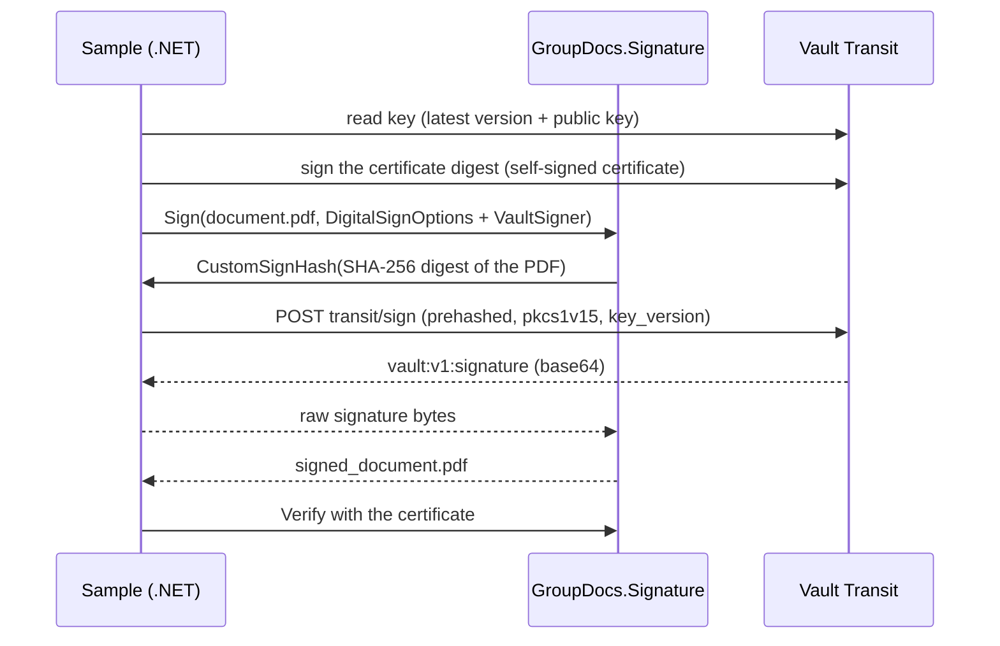

# Signing PDFs with a Key That Stays in HashiCorp Vault

[](https://products.groupdocs.com/signature/net/)
[](https://docs.groupdocs.com/signature/net/)
[](https://blog.groupdocs.com/categories/groupdocs.signature-product-family/)
[](https://forum.groupdocs.com/c/signature/13)
[](https://purchase.groupdocs.com/temporary-license)

## About this repository

External signing is a GroupDocs.Signature capability for .NET that hands the document digest to code you supply instead of signing with a private key the application holds. This sample uses it to sign a PDF while the RSA key stays inside **HashiCorp Vault**: GroupDocs.Signature builds the PDF signature and computes the digest, an `ICustomSignHash` implementation sends only that digest to the Vault **Transit** engine, and Vault returns the signature. The key is created inside Vault and is not exportable, so it never reaches the application at all.

`docker compose up -d` and `dotnet run` are the whole setup. The audience is anyone who has been told the signing key may not live on the application server - regulated signing, a shared CI signer, or an organisation moving off PFX files on disk.

### What is GroupDocs.Signature?

GroupDocs.Signature for .NET is a document signing API. It adds, searches and verifies text, image, barcode, QR code, stamp and digital (X.509 certificate) signatures in PDF, Word, Excel, PowerPoint, image and other formats, without any UI. `DigitalSignOptions.CustomSignHash` is the hook that lets you plug in your own signer - an HSM, a key vault or a smart card.

### What is HashiCorp Vault Transit?

[Vault](https://developer.hashicorp.com/vault) is a server for secrets. Its [Transit secrets engine](https://developer.hashicorp.com/vault/docs/secrets/transit) does cryptography as a service: you send data, Vault signs or encrypts it with a key it keeps, and returns the result. Vault does not store the data you send, which is what makes it a fit for document signing - the PDF never leaves your process, only its 32-byte digest does.

## How it works



1. **Read the key.** The sample reads the Transit key `pdf-signing-key`: its latest version and public key. On the first run it enables Transit and creates an RSA-2048 key.
2. **Make a certificate.** A PDF signature needs a certificate carrying the public key. The sample builds a self-signed certificate around the Vault public key, and Vault signs that certificate too, so no private key exists outside Vault at any point.
3. **Sign the PDF.** GroupDocs.Signature computes the digest and calls `VaultSigner`, which posts it to `transit/sign` with `prehashed=true`, `signature_algorithm=pkcs1v15` and the same `key_version` as the certificate.
4. **Embed and verify.** GroupDocs.Signature embeds the signature and the certificate, then the sample verifies the result cryptographically.

## Prerequisites

- [.NET 10 SDK](https://dotnet.microsoft.com/download)
- [Docker](https://docs.docker.com/get-docker/) (Docker Desktop on Windows and macOS)
- Optional: a GroupDocs licence ([temporary licence](https://purchase.groupdocs.com/temporary-license)). Without one the sample runs in evaluation mode, which accepts documents of up to 2 pages; the included `document.pdf` has 1 page.

## Run the sample

Start Vault in dev mode, then run:

```bash
docker compose up -d
dotnet run --project VaultCustomSignHash
```

The first run prints the one-time setup line as well:

```
No licence file found: running in evaluation mode (documents of up to 2 pages).
Vault: http://localhost:8200
Key 'pdf-signing-key' not found: enabling Transit and creating an RSA-2048 key (one-time setup)...
Signing key: 'pdf-signing-key', version 1
Creating a self-signed certificate for the Vault key (signed by Vault)...
Signing 'document.pdf' (the digest goes to Vault, the key stays there)...
Signed PDF: ...\VaultCustomSignHash\bin\Debug\net10.0\signed_document.pdf
Signature valid: True
```

Later runs skip the setup line, and the exit code is 0 when the signature is valid. Open `signed_document.pdf` in a reader: Adobe Acrobat reports "Document has not been modified" together with "Signer's identity is unknown", because the certificate is self-signed and nobody has vouched for it.

Stop Vault with `docker compose down`. Dev mode keeps everything in memory, so the key is gone afterwards.

To use a licence, put its path into `SetLicense("REPLACE_WITH_YOUR_LICENSE_PATH")` in `Program.cs`. Never commit a licence file; `.gitignore` excludes `*.lic`.

## Configuration

| Setting | Where | Default |
|---------|-------|---------|
| Vault address | `VAULT_ADDR` environment variable | `http://localhost:8200` |
| Vault token | `VAULT_TOKEN` environment variable | `dev-only-token`, the root token of the dev Vault |
| Key name | `KeyName` in `Program.cs` | `pdf-signing-key` |
| Input PDF | `VaultCustomSignHash/Resources/document.pdf` | |
| Output PDF | next to the program | `bin/Debug/net10.0/signed_document.pdf` |

## Code examples

### The external signer

`VaultSigner` is the whole integration: one method that receives a digest and returns a signature.

```csharp
public byte[] CustomSignHash(
    byte[] signableHash,
    HashAlgorithm hashAlgorithm,
    SignatureContext signatureContext)
{
    return _vault.SignHashAsync(
            _keyName, _keyVersion, signableHash, ToVaultHashAlgorithm(hashAlgorithm))
        .GetAwaiter().GetResult();
}
```

`signableHash` is already the digest of the PDF's signed byte range, which is why the Vault request sets `prehashed = true` - hashing it again would sign the wrong value. Since 26.9 `hashAlgorithm` is the algorithm GroupDocs.Signature actually used rather than `Auto`, so it maps one to one onto Vault's names: `Sha256` to `sha2-256`, `Sha384` to `sha2-384`, `Sha512` to `sha2-512`. The interface is synchronous, so the HTTP call is waited on; in a console application there is no synchronization context to deadlock against.

### Signing with a certificate that has no private key

```csharp
var options = new DigitalSignOptions
{
    Signature = new DigitalSignature(certificate) { SignTime = DateTime.Now },
    CustomSignHash = signer,
    HashAlgorithm = HashAlgorithm.Sha256,
    Visible = true,
    VerticalAlignment = VerticalAlignment.Bottom,
    HorizontalAlignment = HorizontalAlignment.Right,
    Margin = new Padding { Bottom = 60, Right = 50 },
    Width = 300,
    Height = 80,
    Reason = "Document signed with HashiCorp Vault Transit",
    Contact = "vault-signer@example.com",
    Location = "HashiCorp Vault"
};
```

Two of those lines are the ones worth copying. `Signature = new DigitalSignature(certificate)` passes the certificate as an object because it holds only a public key; the `DigitalSignOptions(path)` constructor expects a certificate file with a private key and fails with "Specified certificate doesn't contain private key". And `SignTime = DateTime.Now` stores a local time with its offset, where the default UTC time is written without one and readers then interpret it as their own local time.

### Key version and certificate must match

The certificate carries one public key, so the signature has to come from the version that key belongs to:

```csharp
var signer = new VaultSigner(vault, KeyName, key.Version);
```

After `transit/keys/:name/rotate` Vault signs with the newest version by default. A sample that pins the certificate to version 1 and lets Vault sign with version 2 writes a PDF with no error at all - and the signature does not verify. That mismatch is silent, which is why both sides read the same version here.

## Try a least-privilege token

The root token can do everything; a signing application needs two rights - read the key, and sign with it. `vault/sample-signer.hcl` is exactly that policy. With Vault running and the key created:

```bash
docker cp vault/sample-signer.hcl vault-dev:/tmp/sample-signer.hcl
docker exec vault-dev vault policy write sample-signer /tmp/sample-signer.hcl
docker exec vault-dev vault token create -policy=sample-signer -ttl=15m -field=token
```

Set the printed token as `VAULT_TOKEN` and run the sample again: it signs exactly as before. The same token cannot rotate or create keys - Vault answers `403 permission denied`, which is the point.

I piped that policy straight into `docker exec -i ... vault policy write -` the first time and Vault rejected it with "illegal char at 1:1"; copying the file in with `docker cp` and passing a path works.

## Does the PDF ever leave my process?

No. Only a 32-byte SHA-256 digest is sent to Vault, and Transit does not store what it receives. The document itself stays in your application the whole time, so this pattern is usable where the content is confidential but the signing key is managed centrally. What leaves your process is a value that cannot be turned back into the document.

## Production notes

Dev mode is for local tests only: in-memory storage, a fixed root token and plain HTTP. HashiCorp says never to run a [dev server](https://developer.hashicorp.com/vault/docs/concepts/dev-server) in production. For a real deployment:

- **Login:** a short-lived token from an auth method such as [AppRole](https://developer.hashicorp.com/vault/docs/auth/approle), never the root token
- **Rights:** a policy like `vault/sample-signer.hcl`, with an administrator enabling Transit and creating the key ([policies](https://developer.hashicorp.com/vault/docs/concepts/policies))
- **TLS:** `https://` in `VAULT_ADDR` and Vault's CA trusted ([production hardening](https://developer.hashicorp.com/vault/docs/concepts/production-hardening))
- **Certificate:** replace the self-signed certificate with one issued by a CA for the same key - Transit can sign a CSR (`transit/keys/:name/csr`), or Vault's [PKI engine](https://developer.hashicorp.com/vault/docs/secrets/pki) can be the internal CA
- **Key rotation:** after a rotate the newest version signs, and the certificate must belong to the same version; with a CA certificate, get a new one when you rotate
- **Audit:** enable an [audit device](https://developer.hashicorp.com/vault/docs/audit) so every sign request is logged

API reference: [Transit secrets engine API](https://developer.hashicorp.com/vault/api-docs/secret/transit).

## Repository structure

```
sign-pdf-with-hashicorp-vault-transit-dotnet/
  docker-compose.yml                  Vault in dev mode (local only)
  vault/sample-signer.hcl             least-privilege policy example
  VaultCustomSignHash.slnx
  VaultCustomSignHash/
    Program.cs                        reads the key, makes the cert, signs, verifies
    VaultSigner.cs                    ICustomSignHash: digest -> Vault transit/sign
    VaultTransitClient.cs             HTTP calls to the Vault Transit API
    CertificateHelper.cs              self-signed certificate for the Vault key
    VaultX509SignatureGenerator.cs    lets .NET sign the certificate with Vault
    Resources/document.pdf            input document
  images/                             screenshots of the run, Acrobat and the audit log
```

Tested with GroupDocs.Signature 26.9.0, .NET 10 and Vault 2.2.1.

## Related resources

* **Digital signing with custom hash** - the `ICustomSignHash` reference this sample implements: [Read the article →](https://docs.groupdocs.com/signature/net/digital-signing-with-custom-hash/)

* **Sign document with digital signature** - the full `DigitalSignOptions` surface, including appearance and time stamps: [Read the article →](https://docs.groupdocs.com/signature/net/sign-document-with-digital-signature/)

* **Iterative digital signing of a PDF** - adding more than one signature to the same document: [Read the article →](https://docs.groupdocs.com/signature/net/iterative-digital-signing-of-the-pdf-document/)

## Keywords

`hashicorp vault`, `vault transit`, `icustomsignhash`, `external signing`, `pdf digital signature`, `key management`, `key vault`, `groupdocs signature`, `dotnet signing`, `x.509 certificate`, `key rotation`, `least privilege`, `private key protection`, `csharp`, `net10`, `prehashed`, `pkcs1v15`, `rsa-2048`, `docker`, `audit log`, `self-signed certificate`

## License

MIT, see [LICENSE](LICENSE).
